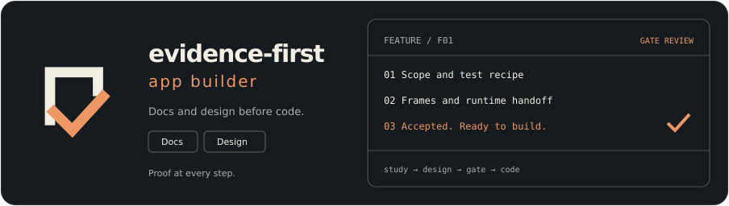

<!-- markdownlint-disable MD041 -->
<!-- markdownlint-configure-file {"MD033": {"allowed_elements": ["p", "img"]}} -->

<p align="center">
  
</p>

#  evidence-first-app-builder

A skill for AI coding agents (and people) that builds an app docs and design first, then code.

Most of the work happens before the first line of feature code:

1. **Plan the features.** Competitor study, a sharpened brief, feature studies with licences and test recipes, a priority matrix, and a numbered checklist.
2. **Design in FigCraft.** Direction, feature to screen to calls map, journeys, states, interaction spec, then the design file: tokens, components, screens, motion, critique, accessibility pass, handoff and a journey manifest.
3. **Build in vertical slices.** Module, fixtures, metric gate, dev CLI, public interface, platform tests, guide, checklist tick with evidence.

The stack is picked from the requirements in an ADR. A shared native core is one option, not the default.

## Use it

The skill is at [`skills/evidence-first-app-builder/SKILL.md`](skills/evidence-first-app-builder/SKILL.md).

- **Claude Code:** add this repo as a plugin, or copy the skill folder into `~/.claude/skills/`.
- **Devin:** install the repo as a plugin, or upload the skill.
- **Other agents:** point the agent at `SKILL.md` before it starts a new app.

## What's inside

```text
skills/evidence-first-app-builder/
  SKILL.md                 Method, phases and docs-and-design gate
  references/              Folder structure and per-phase output contracts
  templates/               Ten fill-in planning, design and proof artifacts
  examples/                One fictional feature gate and journey manifest
```

Start with the [bundle index](skills/evidence-first-app-builder/SKILL.md#bundle-files).
Use the [folder map](skills/evidence-first-app-builder/references/folder-structure.md)
to place files and the [output tables](skills/evidence-first-app-builder/references/outputs.md)
to decide when they are ready. The [worked example](skills/evidence-first-app-builder/examples/offline-ledger.md)
separates a passed design gate from still-unproven runtime behavior.

| Section | Covers |
|---|---|
| Docs-and-design gate | What must exist before any feature code |
| Planning | Doc order, plan template, sharpened brief, spikes, ADRs, feature study format, priority matrix, market and form-factor study, naming and store listing |
| Stack choice | How requirements pick the architecture |
| Vertical slices | The eight things every feature needs to be done |
| Checklists | Gate rules and evidence format |
| Commits | Conventional, atomic, with a why |
| Design (FigCraft) | Study, direction, maps, file pages, build steps, journey manifest, handoff, brand strategy and logo methods, guardrails |
| Web surface | Responsive matrix, i18n and RTL, multilingual SEO |
| Iterating with the owner | Audit first, options with trade-offs, preview, feedback as spec |

## Brand assets

The [brand brief](assets/brand/brief.md) records the mark and palette decisions.
Browse the [kit preview](assets/kit/preview_sheet_lite.html) for variants and exports.
For GitHub Settings > Social preview, upload
`assets/kit/social/github-social-preview.png`. Upload is manual, not set by this repo.

## License

MIT
